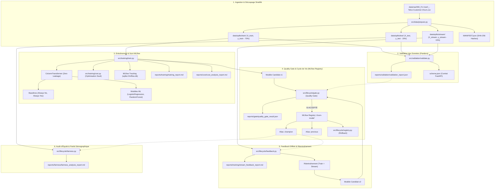

# Architecture Système et Flux de Données — Partie A

Ce document décrit l'architecture modulaire et les flux de données composant la Partie A de la plateforme MLOps Customer Churn.

---

## 1. Diagramme d'Architecture MLOps

---

## 2. Description des Composants

### `src/data/`
- `prepare.py` : Charge le dataset brut, nettoie les chaînes, impute `TotalCharges = 0.0` pour `tenure = 0`, découpe de manière stratifiée et reproductible (graine fixe 42), et génère le `MANIFEST.json`.
- `manifest.py` : Calcule les empreintes SHA-256 de chaque fichier et vérifie à tout moment l'intégrité du dépôt.

### `src/validation/`
- `schema.py` : Déclare les schémas stricts Pandera (`feature_schema`, `target_schema`) et exporte `schema.json` pour la future API de l'étudiant B.
- `validate.py` : Exécute les contrôles de schéma sur les trois splits et consigne le rapport JSON et Markdown.

### `src/training/`
- `pipeline.py` : Construit les pipelines Scikit-learn associant `ColumnTransformer` (StandardScaler pour numériques, OneHotEncoder pour catégorielles, exclusion automatique de `customerID`) et classifieurs.
- `cost.py` : Calcule les matrices de coûts asymétriques ($C_{FN} = 500\$, C_{FP} = 50\$$) et recherche le seuil optimal sur les données d'entraînement.
- `train.py` : Orchestre l'entraînement des baselines et modèles, enregistre les artefacts et métriques dans MLflow, et inscrit le vainqueur au registre.

### `src/lifecycle/`
- `gate.py` : Quality Gate automatique vérifiant la validité des données, le dépassement des baselines, les seuils minimaux (Recall $\ge 0.70$, F1 $\ge 0.50$, ROC-AUC $\ge 0.75$) et la comparaison au champion.
- `registry.py` : Gère les alias `champion` et `previous` dans MLflow Model Registry et orchestre la commande de `rollback`.
- `feedback.py` : Simule l'arrivée différée des étiquettes du stream, calcule les métriques de production constatées, et lance le réentraînement sur données cumulées (v2).
- `fairness.py` : Évalue les écarts de performance sur les attributs protégés `gender` et `SeniorCitizen` (calcul du FPR et du FNR).

---

## 3. Stockage des Données et Artefacts

| Chemin | Contenu | Versionné Git |
|---|---|---|
| `data/raw/` | Dataset source original | Non (protégé) |
| `data/splits/` | Splits `train`, `test`, `stream` (X et y séparés) | Oui |
| `MANIFEST.json` | Métadonnées et hashes SHA-256 | Oui |
| `schema.json` | Contrat JSON des caractéristiques d'entrée pour l'API | Oui |
| `artifacts/` | Modèle champion (.joblib) et métadonnées JSON | Oui |
| `reports/` | Rapports JSON, Markdown et graphiques générés | Oui |
| `mlflow.db` / `mlruns/` | Base de suivi d'expériences et registre de modèles local | Non (reconstructible via `make all`) |
