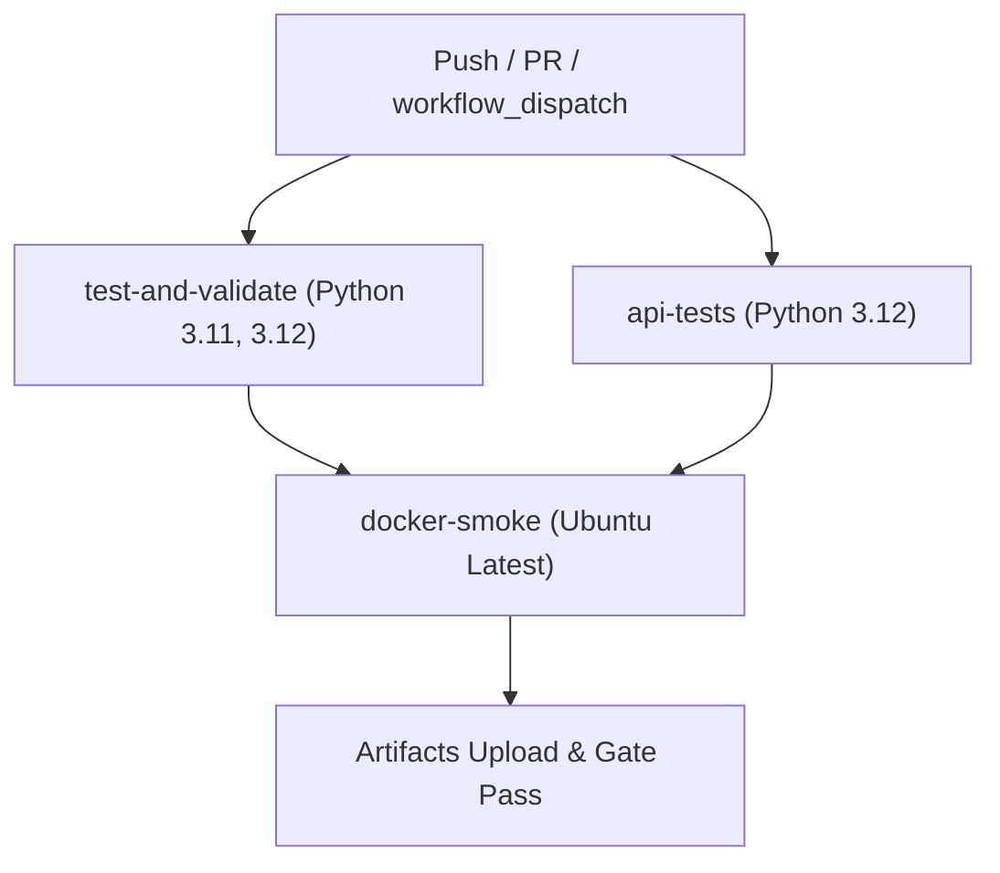

# Continuous Integration & Delivery (CI/CD) Pipeline

This document describes the automated CI/CD pipeline for the Customer Churn Prediction service implemented with GitHub Actions.

---

## 1. Pipeline Architecture & Workflow Jobs

The pipeline is defined in `.github/workflows/ci.yml` under the workflow name **MLOps CI Pipeline**.

It triggers on:
- **Push** to `main` and feature branches matching `feat/**`.
- **Pull Request** targeting `main`.
- **Manual Trigger** via `workflow_dispatch`.



### Job Matrix & Responsibilities

| Job Identifier | Job Name in UI | Environment | Role & Scope | Triggers | Failure Criteria |
|---|---|---|---|---|---|
| `test-and-validate` | `Test and Validate (Python ${{ matrix.python-version }})` | Matrix: Python 3.11, 3.12 | Validates Part A: installs `requirements.txt`, verifies manifest integrity (`python -m src.data.manifest`), runs Pandera data validation (`python -m src.validation.validate`), and runs Pytest test suite excluding API (`pytest tests/ --ignore=tests/api`). | Push to `main`, `feat/**`, PR to `main`, dispatch | Manifest hash mismatch, Pandera schema validation failure, or pytest test failure. |
| `api-tests` | `API Tests (Python 3.12)` | Python 3.12 | Validates Part B API: installs `requirements.txt` and `requirements-api.txt`, checks package consistency (`pip check`), runs FastAPI unit and integration tests (`python -m pytest tests/api`), verifies that tests do not modify versioned files (`git diff --exit-code`). | Push to `main`, `feat/**`, PR to `main`, dispatch | Dependency conflict in `pip check`, failing test in `tests/api`, or any tracked file modified during test execution. |
| `docker-smoke` | `Docker Smoke Tests` | Ubuntu Latest (Docker Engine) | Validates Part B container packaging: builds Docker image with dynamic metadata build arguments, performs automated nominal smoke testing, performs automated degraded smoke testing (absent metadata), verifies OCI labels, security constraints, and healthcheck status. Depends on `needs: [test-and-validate, api-tests]`. | Success of both `test-and-validate` and `api-tests` | Image build failure, container fails to start, nominal checks fail (< 11/11), degraded checks fail (< 4/4), non-zero exit code. |

---

## 2. Artifacts Produced by CI

All test runs and smoke tests generate downloadable artifacts attached to each GitHub Actions workflow run:

| Artifact Name | Generating Job | Contents & Format |
|---|---|---|
| `test-results-${{ matrix.python-version }}` | `test-and-validate` | `reports/junit-test-results.xml` (JUnit XML test results for Part A). |
| `api-test-results` | `api-tests` | `reports/junit-api-results.xml` (JUnit XML test results for FastAPI test suite). |
| `smoke-reports` | `docker-smoke` | `reports/ci/*.json` (Structured JSON reports containing individual check results, timings, HTTP status codes, and label verifications). |

---

## 3. Local Reproduction Guide (PowerShell)

All pipeline checks executed in GitHub Actions can be reproduced locally on a developer workstation running Windows PowerShell with Docker Desktop.

### Execution Commands

```powershell
# 1. Extract build arguments dynamically from git and model metadata
$meta = Get-Content artifacts\model_metadata.json -Raw | ConvertFrom-Json
$env:GIT_COMMIT = (git rev-parse HEAD)
$env:MODEL_RUN_ID = $meta.run_id
$env:MODEL_VERSION = [string]$meta.registry_version

# 2. Build the Docker image with metadata build arguments
docker build --build-arg GIT_COMMIT=$env:GIT_COMMIT --build-arg MODEL_RUN_ID=$env:MODEL_RUN_ID --build-arg MODEL_VERSION=$env:MODEL_VERSION -t churn-api:ci .

# 3. Start nominal container with fast healthcheck parameters
docker run -d --name churn-api-ci -p 8000:8000 --health-interval 5s --health-timeout 3s --health-retries 3 --health-start-period 10s churn-api:ci

# 4. Run nominal smoke test script
python scripts\ci_smoke_test.py nominal --base-url http://127.0.0.1:8000 --container churn-api-ci --image churn-api:ci --commit $env:GIT_COMMIT --report reports/ci/smoke_nominal.json

# 5. Start container in degraded mode with nonexistent metadata path
docker run -d --name churn-api-ci-degraded -p 8001:8000 -e METADATA_PATH=/app/absent.json --health-interval 5s --health-timeout 3s --health-retries 3 --health-start-period 10s churn-api:ci

# 6. Run degraded smoke test script
python scripts\ci_smoke_test.py degraded --base-url http://127.0.0.1:8001 --container churn-api-ci-degraded --report reports/ci/smoke_degraded.json

# 7. Clean up test containers
docker rm -f churn-api-ci churn-api-ci-degraded

# 8. Clean up environment variables
"GIT_COMMIT", "MODEL_RUN_ID", "MODEL_VERSION" | ForEach-Object { Remove-Item "env:$_" -ErrorAction SilentlyContinue }
```

### CLI Exit Codes
- Exit code `0`: All verification checks passed successfully.
- Exit code `1`: At least one verification check failed.
- Exit code `2`: CLI argument or syntax parsing error.

---

## 4. Recommandations (non appliquees)

To enforce high quality and maintain deployment stability, the `main` branch can be protected with GitHub branch protection rules:

1. **Require a pull request before merging**:
   - Direct pushes to `main` are blocked.
   - At least 1 approving review from a maintainer is required.
2. **Require status checks to pass before merging**:
   - Enable "Require branches to be up to date before merging" to prevent merge skew.
   - Add the exact check names displayed by GitHub as required status checks:
     - `Test and Validate (Python 3.11)`
     - `Test and Validate (Python 3.12)`
     - `API Tests (Python 3.12)`
     - `Docker Smoke Tests`
3. **Do not allow bypassing the above settings**:
   - Apply rules to administrators as well.

---

## 5. Known Limitations & Constraints

1. **No Host Bind Mount in CI**:
   - In GitHub Actions Ubuntu runners, the host runner executes under a dynamic runner UID/GID which differs from the container user (`appuser`, UID 1000).
   - Mounting a host volume for `reports/monitoring/` inside CI without explicit root ownership modification would trigger write permission errors.
   - Therefore, the smoke test containers in CI run without host bind mounts. The API server captures disk write errors gracefully without crashing `/predict`.
2. **No Container Registry Push**:
   - The CI workflow builds and validates the Docker image locally on the runner virtual machine.
   - It does not push images to external container registries (e.g., GitHub Packages / GHCR, Docker Hub, AWS ECR) because no external credentials or secrets are configured for this offline-first evaluation repository.
3. **Pull Request Ephemeral Merge Commits**:
   - On `pull_request` events, GitHub Actions checks out the synthetic merge commit `refs/pull/<pr_number>/merge`.
   - The step `Compute Build Metadata` runs `git rev-parse HEAD` on this checked-out commit and exports `GIT_COMMIT` to `$GITHUB_ENV`.
   - The Docker build step then injects this exact commit hash into the OCI label `org.opencontainers.image.revision`, and the smoke test compares the container label against this environment variable.
