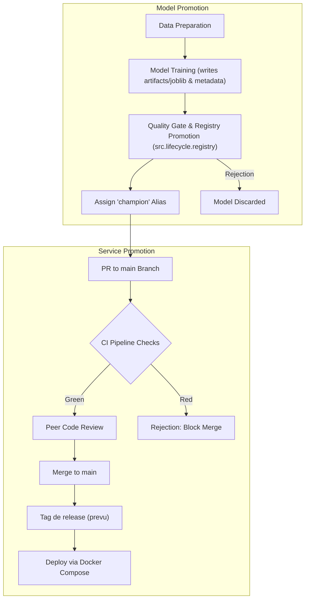

# Production Deployment & Model Lifecycle Strategy

This document specifies the deployment architecture, promotion gates, rollback procedures, and lifecycle governance for the Customer Churn Prediction REST service.

---

## 1. Principles & Deployment Environment

### Local Simulation Paradigm
- **Simulated Production**: In this project, the production environment is simulated using **Docker Compose** on local infrastructure.
- **No Cloud/Kubernetes Complexity**: No Kubernetes clusters, service meshes, or cloud-managed container services are used.
- **Network Dependency Nuance**:
  - **At Runtime (Execution)**: The deployed service operates self-contained without external network calls, remote registry queries, or third-party cloud services.
  - **At Build Time**: Network connectivity is strictly required during image build to pull the base image `python:3.12.10-slim` from Docker Hub and download pinned Python wheels from PyPI.

### Immutable Delivery Unit
The unit of deployment is the Docker image tagged as `churn-api:<tag>`.
Each image packages:
1. Operating system base and Python runtime (`python:3.12.10-slim`).
2. Exact production dependencies (`requirements-serve.txt`).
3. Application code (`src/api/`).
4. Input validation schema (`schema.json`).
5. Frozen serialized machine learning pipeline (`artifacts/champion_model.joblib`).
6. Decision metadata and optimal classification threshold (`artifacts/model_metadata.json`).

### Traceability & Immutability Verification
Every built image embeds verifiable metadata linking code, model experiments, and container images:
- **Git Commit Hash**: Injected as OCI label `org.opencontainers.image.revision`.
- **MLflow Run Identifier**: Injected as label `churn.model.run_id`.
- **MLflow Registry Version**: Injected as label `churn.model.version`.
- **Model Pipeline Digest**: Computed dynamically as SHA-256 over `artifacts/champion_model.joblib`.

### Release Tag Clarification
- The image tag `rel-b3` is a local Docker image tag created on the host via `docker tag` (e.g., `docker tag churn-api:local churn-api:rel-b3`).
- It is neither a published remote image nor a Git repository tag.
- Git release tag: tag Git de release: prevu, non encore cree.

---

## 2. Promotion Pipeline: From Training to Production

The promotion process follows a two-tier governance model: **Model Promotion** (Part A) followed by **Service Promotion** (Part B).



### Stage-by-Stage Promotion Criteria

| Stage | Phase | Action / Responsibility | Statut | Entry Criteria | Exit Gate / Success Criteria |
|---|---|---|---|---|---|
| 1 | Data Preparation | `src.data.prepare` (`python -m src.data.prepare`) | Realise | Raw dataset conforms to schema contract. | Split datasets generated; schema validation passes. |
| 2 | Model Training | `src.training.train` (`python -m src.training.train`) | Realise | Clean train/validation splits. | Models trained; artifacts (`champion_model.joblib`, `model_metadata.json`) serialized; metrics logged to MLflow. |
| 3 | Quality gate et promotion dans le registre | `src.lifecycle.registry` (`python -m src.lifecycle.registry promote 1`) | Realise | Trained candidate models available. | Candidate evaluated by Quality Gate rules; exceeds baseline metrics (AUC-ROC, F1, Recall); MLflow SQLite alias `champion` assigned. |
| 4 | API Implementation | `src/api/` (`python -m pytest tests/api`) | Realise | Frozen champion model and metadata in `artifacts/`. | 59 unit/integration tests in `tests/api` pass; zero side-effects. |
| 5 | Container Packaging | `Dockerfile` & `docker-compose.yml` | Realise | Minimal dependencies pinned in `requirements-serve.txt`. | Single-stage build from `python:3.12.10-slim`, non-root user `appuser` (UID 1000), metadata labels injected, native Python healthcheck configured. |
| 6 | Continuous Integration | GitHub Actions (`.github/workflows/ci.yml`) | Realise | Pull Request opened against `main`. | Run GitHub Actions vert sur feat/b4-ci (Test and Validate 3.11 et 3.12, API Tests, Docker Smoke Tests); preuves B-22 et B-23. |
| 7 | Production Release | Local Docker Compose deployment | Prevu | CI green; peer approval; PR merged to `main`. | Container launched with release tag; `/health` returns 200 with status `ok`. (tag Git de release: prevu, non encore cree). |
| 8 | Continuous Deployment | Automated production push / CD pipeline | Non realise | Automatic deployment to live environments. | Rejected strategy: deployment requires human validation and explicit release tag creation. |

---

## 3. Non-Promotion Scenarios & Failure Handling

Automated gates prevent flawed code or models from advancing to production:

| Scenario / Condition | Failure Mode | Decision | Proof / Diagnostic Evidence |
|---|---|---|---|
| **Quality Gate Failure** | Candidate model achieves lower AUC-ROC or Recall than required baseline. | **REJECT MODEL**: Champion alias remains on existing model; artifacts are not overwritten. | Quality evaluation output logs gate breach; candidate flagged as rejected. |
| **Broken Unit / API Tests** | Code changes introduce regressions in input validation or inference logic. | **BLOCK MERGE**: CI job `api-tests` fails (regle recommandee (3 checks requis), non appliquee a ce jour). | JUnit XML report records test failures; GitHub status check displays red cross. |
| **Fault Injection Smoke Failure** | Container responds with HTTP 200 or predicts when metadata is missing. | **BLOCK IMAGE**: CI job `docker-smoke` fails; release is aborted. | Smoke test runner reports assertion failure (expected 503 unavailable, got 200). |
| **Label / Metadata Discrepancy** | Image labels do not match `run_id` or `registry_version` in `model_metadata.json`. | **BLOCK IMAGE**: Smoke test assertion fails during CI or pre-deployment inspection. | Smoke test log displays mismatch between container label and runtime endpoint response. |
| **Model Hash Corruption** | In-container `champion_model.joblib` SHA-256 differs from host artifact. | **BLOCK DEPLOY**: Container integrity verification fails. | SHA-256 checksum comparison fails during smoke check. |
| **Versioned File Mutation** | Test execution modifies tracked repository files (e.g., reports, data). | **BLOCK MERGE**: Step `Verify No Versioned Files Modified` executes `git diff --exit-code`. | Git diff displays modified files; CI step fails with exit code 1. |

---

## 4. Rollback Strategies

Three distinct rollback mechanisms are supported depending on the operational failure mode:

### Procedure A: Model Registry Rollback (Model Level)
- **Mechanism**: The command `python scripts/run.py rollback` swaps the `champion` and `previous` aliases in the MLflow SQLite database (`mlflow.db`).
- **Critical Caveat**: This command operates **exclusively on the SQLite registry**. It **does NOT** automatically regenerate or overwrite `artifacts/champion_model.joblib` or `artifacts/model_metadata.json`.
- **Consistency Verification & Container Isolation**:
  - The consistency check compares the `run_id` of the `champion` alias in the MLflow registry with the `run_id` stored in `artifacts/model_metadata.json`.
  - The Docker container image does NOT embed `mlflow` (omitted from `requirements-serve.txt`) and therefore never queries the registry; `registry_checked` remains `false` in the container.
  - When the service runs on the host with `USE_REGISTRY=true`, `/model-info` exposes:
    - `registry_checked`: `true`
    - `registry_consistent`: `false` (mismatch between active registry alias and metadata `run_id`).
  - To align the deployed service with the rolled-back model, the model artifacts must be re-exported and the container image rebuilt.

### Procedure B: Release Rollback (Service Level)
- **Mechanism**: Instant rollback to a previously verified release image using Docker Compose environment substitution.
- **Execution (PowerShell)**:
  ```powershell
  # 1. Point to the previously qualified release tag (local Docker tag)
  $env:IMAGE_TAG = "rel-b3"

  # 2. Recreate containers using existing image without rebuilding
  docker compose up -d --no-build

  # 3. Verify health and active model metadata
  curl.exe -s http://127.0.0.1:8000/health
  curl.exe -s http://127.0.0.1:8000/model-info
  ```
- **Verification Evidence**:
  - `GET /model-info` confirms the previous model version, run ID, and optimal threshold are active.
  - `docker inspect` confirms the running container uses the expected image tag and commit label.

### Procedure C: Emergency Stop / Fail-Safe (Circuit Breaker)
- **Mechanism**: If the model file or metadata file is deleted, missing, or corrupted, the service enters a fail-safe unavailable state.
- **Behavior**:
  - `GET /health` immediately returns HTTP 503 with body `{"status":"unavailable"}`.
  - `POST /predict` immediately rejects inference requests with HTTP 503 with detail `"Inference model is unavailable. Prediction cannot be performed."` and no `"prediction"` key. The service never returns fabricated or uncalibrated predictions.
  - Docker Compose healthcheck polling (`interval: 30s`, `timeout: 5s`, `start_period: 15s`, `retries: 3`) marks the container as `unhealthy` after 3 consecutive failures.
  - **Manual Intervention Required**: The compose restart policy `restart: unless-stopped` does NOT restart an unhealthy container (the container remains running in unhealthy state). Operator response is manual: either rolling back to a previous image tag via Procedure B or restoring valid artifact files.

---

## 5. Rejected Alternatives & Architectural Trade-offs

| Alternative Strategy | Why Considered | Why Rejected for This Project |
|---|---|---|
| **Blue / Green Deployment** | Zero-downtime cutover between identical production stacks. | Requires two parallel container environments, an external routing proxy, and extra resource overhead unnecessary for single-node local evaluation. |
| **Canary Releases** | Progressive traffic shifting (e.g., 5% -> 25% -> 100%) to observe live performance. | Requires dynamic traffic-splitting ingress controllers and real-time statistical anomaly monitoring out of scope for a local demonstration. |
| **Automated GHCR / Registry Push** | Centralized image storage for multi-node deployments. | Introduces external network dependencies and required GitHub token permissions for an offline-first academic repository. |
| **Automated Continuous Deployment (CD)** | Automatic rollout to production upon every merge to `main`. | High operational risk in ML systems; requires explicit human-in-the-loop release gating and performance sign-off before production cutover. |

---

## 6. Limitations & Simulated Aspects

1. **Local Docker Daemon**: The deployment runs on a single Docker host. High-availability features (cross-node failover, horizontal pod autoscaling) are not simulated.
2. **Local File Auditing**: Predictions are appended to a local JSONL file (`reports/monitoring/predictions_log.jsonl`) via bind mount, rather than streamed to a centralized distributed log stream.
3. **Registry Isolation**: In containerized production, the container relies on self-contained serialized artifacts rather than live queries to a remote MLflow tracking server, prioritizing zero network latency and operational independence over centralized registry polling.

### Constats herites de la Partie A, a traiter avec l'etudiante A
- docs/HANDOFF.md cite un seuil de 0.20 dans un exemple alors que le seuil de reference est celui de artifacts/model_metadata.json.
- Les metriques du rapport de feedback sur le flux (stream) paraissent superieures a celles du jeu de test (ROC-AUC proche de 0.93 contre 0.84); le champion v2 a ete reentraine sur donnees accumulees (train + stream, voir retrain_and_gate_candidate dans src/lifecycle/feedback.py), ce qui rend ces metriques optimistes. A confirmer avec la Partie A avant toute utilisation dans le rapport.
