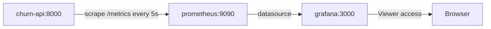

# Monitoring Stack: Prometheus + Grafana

This document describes the optional monitoring stack added for B5a. It is activated via Docker Compose profiles and does not change the default `docker compose up` behaviour.

---

## 1. Architecture



The stack has three services:

| Service | Image | Port | Description |
|---|---|---|---|
| `api` | `churn-api:local` (default) | `127.0.0.1:8000` | FastAPI inference service. Always started. |
| `prometheus` | `prom/prometheus:v2.53.3` | `127.0.0.1:9090` | Metrics collector. Profile `monitoring` only. |
| `grafana` | `grafana/grafana:11.4.0` | `127.0.0.1:3000` | Dashboard UI. Profile `monitoring` only. |

All ports are bound to `127.0.0.1` only. No port is exposed to the network.

---

## 2. Starting and Stopping (PowerShell)

### Start the full stack (API + Prometheus + Grafana)

```powershell
# 1. Set build metadata (read from git and model_metadata.json)
$meta = Get-Content artifacts\model_metadata.json -Raw | ConvertFrom-Json
$env:GIT_COMMIT = (git rev-parse HEAD)
$env:MODEL_RUN_ID = $meta.run_id
$env:MODEL_VERSION = [string]$meta.registry_version

# 2. Start all services with the monitoring profile
docker compose --profile monitoring up -d --build

# 3. Wait for api to report healthy (about 20s)
docker compose --profile monitoring ps
```

### Start the API alone (default, no monitoring overhead)

```powershell
docker compose up -d
```

### Stop the monitoring stack (data volumes are preserved)

```powershell
docker compose --profile monitoring down
```

### Stop and remove all named volumes (destructive - clears Prometheus and Grafana data)

```powershell
docker compose --profile monitoring down -v
```

---

## 3. Service URLs

| Service | URL | Credentials |
|---|---|---|
| Churn API | http://127.0.0.1:8000 | None |
| Churn API Metrics | http://127.0.0.1:8000/metrics | None |
| Prometheus UI | http://127.0.0.1:9090 | None |
| Grafana UI | http://127.0.0.1:3000 | Anonymous Viewer (no login); admin: see below |

---

## 4. Metrics Catalogue

### 4.1 Service Metrics

| Metric Name | Type | Labels | Description |
|---|---|---|---|
| `http_requests_total` | Counter | `method`, `endpoint`, `status_code` | Total HTTP requests processed since startup. |
| `http_request_duration_seconds` | Histogram | `method`, `endpoint` | End-to-end request latency (default Prometheus buckets). |
| `model_ready` | Gauge | none | 1 if the model pipeline loaded successfully, 0 otherwise. |

### 4.2 Model Metrics

| Metric Name | Type | Labels | Description |
|---|---|---|---|
| `predictions_total` | Counter | `predicted_class` (`Yes` / `No`) | Total inference decisions emitted since startup. |
| `model_info` | Gauge | `version` | Deployment indicator; always 1 with the active model version label. |
| `churn_prediction_probability` | Histogram | none | Raw churn probability scores (buckets 0.0 to 1.0 step 0.1). Fed with the unrounded probability of every successful prediction. |
| `model_decision_threshold` | Gauge | none | Optimal classification threshold read from `model_metadata.json` at startup and refreshed on each `/metrics` scrape. |

---

## 5. Grafana Dashboard

The dashboard `churn-api-overview` (uid `churn-api-overview`) is provisioned automatically on startup.

### Row: SERVICE

| Panel | PromQL Expression | Description |
|---|---|---|
| Target Up | `up{job="churn-api"}` | 1 = Prometheus can reach the API, 0 = unreachable. |
| Model Ready | `model_ready` | Model load status (1 = ready). |
| Request Rate by HTTP Code | `sum by (status_code)(rate(http_requests_total[2m]))` | Per-code request throughput. |
| Error Rate 4xx | `sum(rate(...{status_code=~"4.."}[2m])) / sum(rate(...[2m]))` | Fraction of client-side errors (e.g. 422). |
| Error Rate 5xx | Same with `5..` | Fraction of server-side errors. |
| Latency /predict (p50, p95) | `histogram_quantile(0.50/0.95, ...)` | Tail latency on inference endpoint. |

### Row: MODEL

| Panel | PromQL Expression | Description |
|---|---|---|
| Predictions per Class | `sum by (predicted_class)(rate(predictions_total[2m]))` | Yes/No split over time. |
| Positive Prediction Rate | `sum(rate(predictions_total{predicted_class="Yes"}[5m])) / sum(rate(predictions_total[5m]))` | Rolling churn rate - signals distribution drift. |
| Churn Probability Distribution | `sum by (le)(increase(churn_prediction_probability_bucket[5m]))` | Histogram shape; reveals model confidence. |
| Decision Threshold | `model_decision_threshold` | Current threshold value from metadata. |
| Model Version | `model_info` | Active registry version label. |

---

## 6. Configuration Files

| File | Description |
|---|---|
| `monitoring/prometheus/prometheus.yml` | Scrape config: `scrape_interval 5s`, target `api:8000`. |
| `monitoring/grafana/provisioning/datasources/prometheus.yml` | Auto-provisions Prometheus as the default datasource. |
| `monitoring/grafana/provisioning/dashboards/dashboards.yml` | Auto-provisions dashboards from `monitoring/grafana/dashboards/`. |
| `monitoring/grafana/dashboards/churn-api.json` | Pre-built dashboard (uid `churn-api-overview`). |

---

## 7. Image Tags

Exact Docker image tags used (never `latest`):

| Image | Tag | Digest (at time of pull) |
|---|---|---|
| `prom/prometheus` | `v2.53.3` | `sha256:c62e2f333beae2fdac8c3c7a3daaa7ac81110023cbc5857b0ec541f09d997951` |
| `grafana/grafana` | `11.4.0` | `sha256:d8ea37798ccc41061a62ab080f2676dda6bf7815558499f901bdb0f533a456fb` |

---

## 8. Known Limitations

1. **Anonymous Viewer Access**: Grafana is configured with `GF_AUTH_ANONYMOUS_ENABLED=true` and `GF_AUTH_ANONYMOUS_ORG_ROLE=Viewer`. Anyone with network access to port 3000 can view dashboards without authentication. This is acceptable for local development only. Never expose port 3000 to external networks.

2. **Default Admin Password**: The Grafana admin password is set via `GRAFANA_ADMIN_PASSWORD` (default: `admin`). This default is intentional for local evaluation. Set a strong password in production via the environment variable before exposing the service.

3. **No Alertmanager**: No alerting rules or Alertmanager are configured at this stage. Alerts are planned for B5b.

4. **No Alerting at This Stage**: The `rule_files` section of `prometheus.yml` is empty. No alert rules are evaluated.

5. **Single-Node**: Prometheus storage is a named Docker volume on the local host. No remote write, no clustering, no long-term storage backend (Thanos, Cortex) is configured.

6. **Linux Bind Mount Note**: If running on Linux with a host user different from the container user (UID 1000 for the API, root for Prometheus/Grafana official images), bind mount permissions may differ from Windows/Docker Desktop behaviour. Named volumes avoid this issue for Prometheus and Grafana data.
