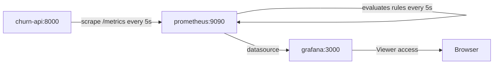

# Monitoring Stack: Prometheus + Grafana

This document describes the monitoring stack added for B5 (metrics in B5a, alerting rules and degraded scenarios in B5b). It is activated via Docker Compose profiles and does not change the default `docker compose up` behaviour.

---

## 1. Architecture



The stack has three services:

| Service | Image | Port | Description |
|---|---|---|---|
| `api` | `churn-api:local` (default) | `127.0.0.1:8000` | FastAPI inference service. Always started. |
| `prometheus` | `prom/prometheus:v2.53.3` | `127.0.0.1:9090` | Metrics collector and alerting evaluator. Profile `monitoring` only. |
| `grafana` | `grafana/grafana:11.4.0` | `127.0.0.1:3000` | Dashboard UI. Profile `monitoring` only. |

All ports are bound to `127.0.0.1` only. No port is exposed to the public network.

---

## 2. Starting and Stopping (PowerShell)

### Start the full stack (API + Prometheus + Grafana)

```powershell
# 1. Set build metadata (read dynamically from git and model_metadata.json)
$meta = Get-Content artifacts\model_metadata.json -Raw | ConvertFrom-Json
$env:GIT_COMMIT = (git rev-parse HEAD)
$env:MODEL_RUN_ID = $meta.run_id
$env:MODEL_VERSION = [string]$meta.registry_version

# 2. Start all services with the monitoring profile
docker compose --profile monitoring up -d --build

# 3. Wait for api to report healthy (about 20s)
docker compose --profile monitoring ps
```

### Start the API alone (default, no monitoring overhead)

```powershell
docker compose up -d
```

### Stop the monitoring stack (data volumes are preserved)

```powershell
docker compose --profile monitoring down
```

### Stop and remove all named volumes (destructive - clears Prometheus and Grafana data)

```powershell
docker compose --profile monitoring down -v
```

---

## 3. Service URLs

| Service | URL | Credentials |
|---|---|---|
| Churn API | http://127.0.0.1:8000 | None |
| Churn API Metrics | http://127.0.0.1:8000/metrics | None |
| Prometheus UI | http://127.0.0.1:9090 | None |
| Grafana UI | http://127.0.0.1:3000 | Anonymous Viewer (no login); admin: see below |

---

## 4. Metrics Catalogue

### 4.1 Service Metrics

| Metric Name | Type | Labels | Description |
|---|---|---|---|
| `http_requests_total` | Counter | `method`, `endpoint`, `status_code` | Total HTTP requests processed since startup. |
| `http_request_duration_seconds` | Histogram | `method`, `endpoint` | End-to-end request latency (default Prometheus buckets). |
| `model_ready` | Gauge | none | 1 if the model pipeline loaded successfully, 0 otherwise. |

### 4.2 Model Metrics

| Metric Name | Type | Labels | Description |
|---|---|---|---|
| `predictions_total` | Counter | `predicted_class` (`Yes` / `No`) | Total inference decisions emitted since startup. |
| `model_info` | Gauge | `version` | Deployment indicator; always 1 with the active model version label. |
| `churn_prediction_probability` | Histogram | none | Raw churn probability scores (buckets 0.0 to 1.0 step 0.1). Fed with the unrounded probability of every successful prediction. |
| `model_decision_threshold` | Gauge | none | Optimal classification threshold read from `model_metadata.json` at startup and refreshed on each `/metrics` scrape. |

---

## 5. Grafana Dashboard

The dashboard `churn-api-overview` (uid `churn-api-overview`) is provisioned automatically on startup with 12 panels.

### Row: SERVICE

| Panel | Type | PromQL Expression | Description |
|---|---|---|---|
| Target Up | `stat` | `up{job="churn-api"}` | 1 = Prometheus can reach the API, 0 = unreachable. |
| Model Ready | `stat` | `model_ready` | Model load status (1 = ready). |
| Request Rate by HTTP Code | `timeseries` | `sum by (status_code)(rate(http_requests_total[2m]))` | Per-code request throughput. |
| Error Rate 4xx | `stat` | `sum(rate(http_requests_total{status_code=~"4.."}[2m])) / sum(rate(http_requests_total[2m])) or vector(0)` | Fraction of client-side validation errors (e.g. 422). |
| Error Rate 5xx | `stat` | `sum(rate(http_requests_total{status_code=~"5.."}[2m])) / sum(rate(http_requests_total[2m])) or vector(0)` | Fraction of server-side errors (uses vector(0) fallback). |
| Latency /predict (p50, p95) | `timeseries` | `histogram_quantile(0.50/0.95, sum by (le) (rate(http_request_duration_seconds_bucket{endpoint="/predict"}[2m])))` | Tail latency on inference endpoint. |

### Row: MODEL

| Panel | Type | PromQL Expression | Description |
|---|---|---|---|
| Predictions per Class | `timeseries` | `sum by (predicted_class)(rate(predictions_total[2m]))` | Yes/No prediction throughput split over time. |
| Positive Prediction Rate | `timeseries` | `sum(rate(predictions_total{predicted_class="Yes"}[5m])) / sum(rate(predictions_total[5m]))` | Rolling positive churn prediction rate over 5m window (baseline 0.49; signals distribution drift). |
| Churn Probability Distribution | `heatmap` | `sum by (le) (increase(churn_prediction_probability_bucket[5m]))` | Heatmap format showing confidence score distribution across 0.1 probability buckets. |
| Decision Threshold | `stat` | `model_decision_threshold` | Current classification threshold read from metadata. |
| Model Version | `stat` | `model_info` | Active model registry version; displays label name ('version') rather than numeric value 1. |

### Row: ALERTS

| Panel | Type | PromQL Expression | Description |
|---|---|---|---|
| Alertes actives | `table` | `ALERTS{alertstate="firing"}` | Live table of currently firing Prometheus alerts with alertname, severity, and start time. |

---

## 6. Prometheus Alert Rules

Rules are defined in `monitoring/prometheus/alerts.yml` under the group `churn-api` (evaluation interval: 5s).

### 6.1 Recording Rules

| Name | PromQL Expression | Purpose |
|---|---|---|
| `churn:positive_rate_3m` | `sum(increase(predictions_total{predicted_class="Yes"}[3m])) / sum(increase(predictions_total[3m]))` | Computes rolling positive churn prediction rate over 3m window. Shared between dashboard and drift alert. |

### 6.2 Alert Rules

| Alert Name | PromQL Expression | For | Threshold | Severity | Decision |
|---|---|---|---|---|---|
| `ChurnApiDown` | `up{job="churn-api"} == 0` | 1m | `== 0` | `critical` | Check container status via docker compose ps and restart the api container if needed. |
| `ChurnModelNotReady` | `model_ready == 0` | 30s | `== 0` | `critical` | Verify model artifacts presence and integrity in artifacts/, then initiate release rollback according to docs/deployment_strategy.md if required. |
| `ChurnHighServerErrorRate` | `sum(rate(http_requests_total{endpoint="/predict",status_code=~"5.."}[2m])) / sum(rate(http_requests_total{endpoint="/predict"}[2m])) > 0.05` | 2m | `> 0.05` | `critical` | Inspect container logs for internal exceptions or inference pipeline failures; investigate potential bad payloads or code defects. |
| `ChurnHighValidationErrorRate` | `sum(rate(http_requests_total{endpoint="/predict",status_code="422"}[2m])) / sum(rate(http_requests_total{endpoint="/predict"}[2m])) > 0.20` | 2m | `> 0.20` | `warning` | Investigate upstream client payload contract adherence and data pipeline schema changes; do not retrain the model. |
| `ChurnHighLatencyP95` | `histogram_quantile(0.95, sum by (le) (rate(http_request_duration_seconds_bucket{endpoint="/predict"}[5m]))) > 0.5` | 5m | `> 0.5` | `warning` | Check host CPU, memory, and I/O resource utilization; inspect concurrent traffic and worker scaling. |
| `ChurnPositiveRateShift` | `(abs(churn:positive_rate_3m - 0.49) > 0.12) and (sum(increase(predictions_total[3m])) >= 100)` | 1m | `> 0.12 and predictions >= 100` | `warning` | Investigate distribution drift with an Evidently data and concept drift report; this signal indicates feature distribution change and does not prove model failure on its own; do not retrain immediately. |

---

## 7. Scenarios and Empirical Validation

The alerts and metrics were empirically validated against 4 operational scenarios using `scripts/traffic_generator.py` and Docker configuration overrides.

### Scenario S0: Nominal Traffic (Stable)

- **Command**:
  ```powershell
  .venv\Scripts\python.exe scripts/traffic_generator.py stable
  ```
- **Observed Metrics**:
  - Total requests: 1056 requests, all returning HTTP 200.
  - Positive rate: 0.4905 (518/1056, identical to offline computation with the model).
  - Server-side latency: p50 = 0.0381 s, p95 = 0.0499 s.
- **Alert State**:
  - No active alerts (`ALERTS{alertstate="firing"}` is empty).
  - Stack remains fully nominal.

### Scenario S1: Degraded - Schema Validation Failures (Invalid Traffic)

- **Command**:
  ```powershell
  .venv\Scripts\python.exe scripts/traffic_generator.py invalid --duration 300
  ```
- **Observed Metrics**:
  - Duration: 300 s.
  - Total requests: 3898 requests (2342 returning HTTP 200, 1556 returning HTTP 422, representing 39.9%).
- **Alert State**:
  - `ChurnHighValidationErrorRate`: pending 48 s after start, firing 121 s later (activeAt `2026-11-23T02:51:33Z`, alert value 0.396).
- **Resolution**:
  - Inactive 124 s after the end of traffic.

### Scenario S2: Degraded - Distribution / Concept Drift (Drift Traffic)

- **Command**:
  ```powershell
  .venv\Scripts\python.exe scripts/traffic_generator.py drift --duration 360
  ```
- **Observed Metrics**:
  - Duration: 360 s.
  - Total requests: 3167 requests, all returning HTTP 200.
  - Actual throughput: 8.8 req/s (loaded host machine).
  - PromQL `churn:positive_rate_3m`: 0.7247 during the scenario.
  - Cumulative positive rate: 0.718 (2274 positive predictions out of 3167), deviation of 0.0067 with the 3m rate.
- **Alert State**:
  - `ChurnPositiveRateShift`: pending 18 s after start, firing 57 s later (activeAt `2026-11-23T02:59:33Z`, alert value 0.2291).
- **Resolution**:
  - Inactive 169 s after the end of traffic.

### Scenario S3: Degraded - Inference Model Unavailable

- **Command**:
  ```powershell
  $env:METADATA_PATH = "/app/absent.json"
  docker compose --profile monitoring up -d --force-recreate api
  ```
- **Observed Metrics**:
  - API returns HTTP 503 on `/health` and `/predict`.
  - PromQL `model_ready`: drops to 0.
- **Alert State**:
  - `ChurnModelNotReady`: firing 45 s after `docker compose up --force-recreate` with `METADATA_PATH=/app/absent.json` (activeAt `2026-11-23T03:10:18Z`).
- **Resolution**:
  ```powershell
  Remove-Item Env:METADATA_PATH
  docker compose --profile monitoring up -d --force-recreate api
  ```
  - Inactive 15 s after the return of the model.
  - API healthy about 1 minute after.

---

## 8. Configuration Files

| File | Description |
|---|---|
| `monitoring/prometheus/prometheus.yml` | Scrape config: `scrape_interval 5s`, target `api:8000`, loads `alerts.yml`. |
| `monitoring/prometheus/alerts.yml` | Group `churn-api`: 1 recording rule and 6 alerting rules. |
| `monitoring/prometheus/alerts_test.yml` | Unit tests for all alerting rules (tested with `promtool test rules`). |
| `monitoring/grafana/provisioning/datasources/prometheus.yml` | Auto-provisions Prometheus as the default datasource. |
| `monitoring/grafana/provisioning/dashboards/dashboards.yml` | Auto-provisions dashboards from `monitoring/grafana/dashboards/`. |
| `monitoring/grafana/dashboards/churn-api.json` | Pre-built 12-panel dashboard (uid `churn-api-overview`). |

---

## 9. Image Tags

Exact Docker image tags used (never `latest`):

| Image | Tag | Digest (at time of pull) |
|---|---|---|
| `prom/prometheus` | `v2.53.3` | `sha256:c62e2f333beae2fdac8c3c7a3daaa7ac81110023cbc5857b0ec541f09d997951` |
| `grafana/grafana` | `11.4.0` | `sha256:d8ea37798ccc41061a62ab080f2676dda6bf7815558499f901bdb0f533a456fb` |

---

## 10. Known Limitations

1. **Client Clock Resolution vs Server Latency**: Latencies displayed by the client-side traffic generator are multiples of 15.6 ms due to Windows system timer resolution (`time.time()` quantum). Only the server-side latency recorded by the Prometheus histogram (`http_request_duration_seconds`) is authoritative.

2. **Error Rate 4xx Initial "No data"**: The Grafana panel for Error Rate 4xx displays "No data" until at least one HTTP 4xx request has occurred, because Prometheus does not instantiate time series for label combinations that have never been emitted.

3. **ChurnHighLatencyP95 Validated via Unit Test Only**: Under nominal and degraded traffic loads, actual server-side API p95 latency is ~0.0499s, well below the 0.5s threshold. Validating this alert empirically would require synthetic host throttling or heavy distributed load; it is therefore formally verified via unit tests in `monitoring/prometheus/alerts_test.yml`.

4. **No Alertmanager (No External Notifications)**: Prometheus evaluates alerting rules and displays their status in the Prometheus Web UI (`/alerts`) and on the Grafana dashboard (`Alertes actives` table). However, no Alertmanager service is deployed: alerts do not generate external notifications (email, Slack webhook, or PagerDuty).

5. **Anonymous Viewer Access**: Grafana is configured with `GF_AUTH_ANONYMOUS_ENABLED=true` and `GF_AUTH_ANONYMOUS_ORG_ROLE=Viewer`. Anyone with network access to port 3000 can view dashboards without authentication. This is suitable for local development only.

6. **Default Admin Password**: The Grafana admin password defaults to `admin` via `GRAFANA_ADMIN_PASSWORD`. In production, set a strong password via environment variable before exposing the port.

7. **Single-Node Storage**: Prometheus metrics are stored in a local Docker named volume. No remote storage backend (Thanos, Cortex) is configured.

8. **Linux Bind Mount Note**: Under Linux with a non-root host user, bind mount permissions may differ from Windows Docker Desktop. Named volumes avoid this for Prometheus and Grafana.
